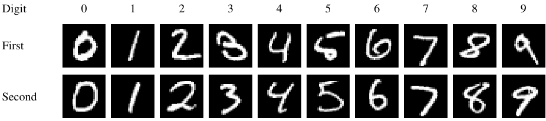
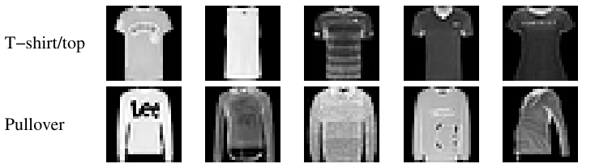
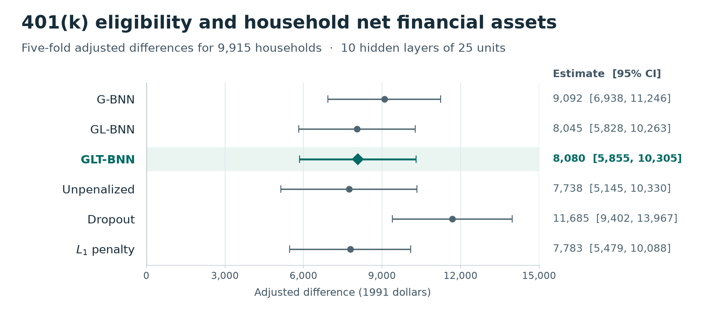

# gltbnn

**Bayesian neural networks with shrinkage on individual hidden weights and biases.**

The R package accompanying *Variational Learning of Bayesian Neural Networks with a family of global–local shrinkage priors* fits ReLU networks under global (G), horseshoe (GL), and global–local–tail (GLT) priors. It supports continuous, binary, and unordered categorical responses.

[Follow one fitting cycle](https://yain22.github.io/Bayesian_NN_GLT/computation/cycle.html) · [Fit a model in R](#installation) · [Explore the results](#simulation-results) · [Package website](https://yain22.github.io/Bayesian_NN_GLT/)

## How variational fitting works

Suppose we want to predict a tree’s timber volume from its diameter and height. In one fitting cycle, the network updates a distribution for each weight. Its expected square helps determine the amount of shrinkage the weight receives next. The [interactive walkthrough](https://yain22.github.io/Bayesian_NN_GLT/computation/cycle.html) follows the diameter weight of one hidden unit through Figure 8 of the paper. Switch priors to see which calculations change, or use the [R examples and update equations](https://yain22.github.io/Bayesian_NN_GLT/computation/) to reproduce the fits.

## Installation

Download the source package from the [GitHub release](https://github.com/yain22/Bayesian_NN_GLT/releases/latest). In R 4.1 or later, run the following and choose the downloaded `.tar.gz` file.

```r
install.packages(file.choose(), repos = NULL, type = "source")
library(gltbnn)
```

## Fit a regression network

Use trunk diameter (the `Girth` column) and height to predict black cherry timber volume. Hold three trees out of training. Here `hidden = 4L` gives the network one hidden layer with four neurons.

```r
x <- trees[c("Girth", "Height")]
holdout <- c(4, 14, 24)

fit <- gltbnn_fit(
  x[-holdout, ], trees$Volume[-holdout],
  hidden = 4L, prior = "GLT", seed = 7L,
  noise_prior = c(shape = 2, scale = 1)
)
predict(fit, x[holdout, ])
predict(fit, x[holdout, ], type = "prediction_interval")
```

This example uses a proper inverse-gamma prior on the standardized observation variance. The first prediction estimates mean volume at each new input $\mathbf{x}_*$ by averaging the network output over draws from the fitted variational distribution. The manuscript denotes this point prediction by $\widehat{Y}(\mathbf{x}_*)$. The second gives a 95% variational predictive interval for an individual tree, including observation noise. Use `type = "mean_interval"` for uncertainty in the mean. Predictions are returned in the original response units.

Use `gltbnn_shrinkage(fit)` to inspect each incoming weight and bias. The returned columns identify the layer, receiving unit and incoming coordinate. [R reference manual](https://yain22.github.io/Bayesian_NN_GLT/reference.pdf)

## Fit a classifier

Set `outcome = "binary"` to model the log odds of the second response level or `outcome = "categorical"` to model multiple classes. In the categorical model the last level is the reference. Supply a factor to choose the level order. Predictions average class probabilities over variational weight draws and return them in that order.

```r
flowers <- droplevels(subset(iris, Species != "setosa"))
holdout <- seq(5, nrow(flowers), by = 5)
fit <- gltbnn_fit(flowers[-holdout, 1:4], flowers$Species[-holdout],
                  outcome = "binary", prior = "GL", hidden = 4L)
head(predict(fit, flowers[holdout, 1:4], type = "prob"))
```

- Inspect predicted probabilities of a malignant diagnosis on held-out Wisconsin Diagnostic Breast Cancer observations and vary the classification threshold. [Binary application and R code](https://yain22.github.io/Bayesian_NN_GLT/classification/#binary)
- Fit a categorical network to MNIST, select a held-out handwritten digit, and inspect its ten class probabilities. [MNIST application and R code](https://yain22.github.io/Bayesian_NN_GLT/classification/#mnist)
- Compare T-shirt and pullover probabilities on ten held-out Fashion-MNIST images and inspect accuracy and log loss across all 36 fits. [Fashion-MNIST application and replication code](https://yain22.github.io/Bayesian_NN_GLT/classification/fashion/)
- Trace a CIFAR-10 color pixel into a standardized network input, compare cat and dog probabilities, and inspect all 36 fits on the full cat/dog split. [CIFAR-10 application and replication code](https://yain22.github.io/Bayesian_NN_GLT/classification/cifar/)

## What each prior shrinks

The [fitting cycle guide](https://yain22.github.io/Bayesian_NN_GLT/computation/cycle.html) follows a hidden coefficient through the weight and scale updates for the tree-volume example. The [step-by-step fitting algorithms](https://yain22.github.io/Bayesian_NN_GLT/computation/algorithms.html) show the equations, R implementation and fitting budget for G, GL and GLT. The [interactive ELBO replay](https://yain22.github.io/Bayesian_NN_GLT/computation/elbo-replay.html) follows three matched fits for each simulation setting and initialization. The [R scripts](docs/computation/) fit all three priors to the same training trees, predict volume for six held-out trees and reproduce the GLT quadrature check in Supplement Section S5.1.

For Gaussian regression, the package standardizes the training response and uses the Jeffreys prior $p(\sigma^2)\propto1/\sigma^2$ by default. Posterior propriety with this prior depends on the data. To use the supplement's proper inverse-gamma alternative, pass positive hyperparameters, for example `noise_prior = c(shape = 2, scale = 1)`.

For neuron $k$ in layer $l$, the vector $\mathbf{w}_{kl}$ contains its $d_l=K_{l-1}+1$ incoming weights, including its bias at $j=d_l$. Its scalar coefficient $w_{kl,j}$ has a zero-centered Gaussian prior with conditional standard deviation $\sigma\lambda_{kl,j}$ in regression and $\lambda_{kl,j}$ in classification. A small local scale concentrates the prior for that individual coefficient near zero. There are $M_l=K_l d_l$ such coefficients in layer $l$.

| `prior` | How the model sets the coefficient scale |
| --- | --- |
| `"G"` | Every coefficient in a layer shares $\lambda_{kl,j}=\tau_l$. |
| `"GL"` | Independent standard half-Cauchy multipliers $r_{kl,j}$ give $\lambda_{kl,j}=\tau_l r_{kl,j}$. |
| `"GLT"` | The coefficient scales follow a generalized Pareto distribution conditional on the layer scale $\tau_l$ and learned tail shape $\xi_l$. |

G and GL learn the layer scale $\tau_l$ under a half-Cauchy prior with fixed scale parameter $1/M_l$. For GLT, $\tau_l\mid\xi_l$ has an inverse-gamma prior with shape $1+M_l/\xi_l$ and scale 1.

Trace incoming connections in the architecture illustration, or compare mean-response and future-observation intervals from three fitted networks. [Architecture illustration](https://yain22.github.io/Bayesian_NN_GLT/illustration/) · [Prediction illustration](https://yain22.github.io/Bayesian_NN_GLT/prediction/)

## Simulation results

Select the signal design, training signal-to-noise ratio, depth and width to compare shrinkage among connections entering a neuron. The simulation explorer reports matched prediction errors and Monte Carlo standard errors across 100 replicates and provides the benchmark tables. [Explore the simulation results](https://yain22.github.io/Bayesian_NN_GLT/study/)

To reproduce one comparison, run the [C2 replication script](tools/replication/c2-additive.R) with the package installed. It generates the data, fits all six methods from a common initialization, and reports held-out errors and 90% interval coverage. With `jsonlite` installed, pass `--write-neuron-scales` from the repository root to regenerate the fitted-neuron panel’s individual weight and bias scales.

## Image classification applications

### MNIST handwritten digits



*The first and second test images for each digit in official file order. [MNIST image credits and license](tools/replication/mnist/data/README.md).*

**Can a network recognize all ten digits?** Section 5.3 trains six methods on **60,000 images** and evaluates them on **10,000 test images**. Across the 36 fits, GLT with two hidden layers of 25 units correctly classified **9,628 digits (96.28%)**. GL with five 25-unit layers gave the lowest mean log loss (0.125).

[MNIST test scores](tools/replication/mnist/summary/scores.csv) · [Rescore the 36 saved fits](tools/replication/mnist/#rescore-the-36-saved-fits) · [Train all 36 networks from scratch](tools/replication/mnist/#train-all-36-networks-from-scratch) · [Try the small R demo (1,000 training and 300 test images)](docs/classification/mnist.R)

### Fashion-MNIST T-shirts and pullovers



*The first five T-shirt/top and pullover images in official test-file order. Images from Zalando’s [Fashion-MNIST dataset](https://github.com/zalandoresearch/fashion-mnist), used under its [MIT license](tools/replication/fashion/data/LICENSE).*

**Can a network distinguish a pullover from a T-shirt or top?** Section 5.4 uses **12,000 training images** and **2,000 test images**, evenly split between the two classes. Dropout with ten 10-unit layers correctly classified **1,941 garments (97.05%)**. The most accurate Bayesian fit was GLT with five 25-unit layers (**96.75%**). GL with five 10-unit layers gave the lowest mean log loss (0.092).

[Fashion-MNIST test scores](docs/classification/fashion/scores.csv) · [Full replication in R](tools/replication/fashion/)

## Double Machine Learning Applications

How do net financial assets differ between households with and without access to an employer-sponsored 401(k) plan? This example uses 9,915 households from the 1991 Survey of Income and Program Participation.

**Run the example in R.** Install gltbnn 0.2.1 using the [installation instructions](#installation), then run the command below. The package includes the data. The demo prints the R code as it fits two asset regressions and an eligibility model in each of five folds, then combines the predictions to estimate the adjusted difference.

~~~r
demo("aipw401k", package = "gltbnn", ask = FALSE)
~~~

**Expected result.** GLT-BNN with ten hidden layers of 25 units gives a cross-fitted, adjusted difference in net financial assets of **$8,080** between eligible and ineligible households (standard error **$1,135**, 95% confidence interval **$5,855 to $10,305**), in 1991 dollars.



*Eligible minus ineligible households, in 1991 dollars. All six methods use the same five folds and ten hidden layers of 25 units. Lines are pointwise 95% confidence intervals.* [Estimates (CSV)](tools/replication/401k/reference/aipw_estimates.csv) · [Plotting script](tools/replication/401k/plot_401k.py)

A total-effect interpretation requires the adjustment assumptions in Supplement S7.1. In particular, the analysis uses current individual retirement account (IRA) participation as a covariate. If eligibility changed whether a household held IRA assets, adjusting for IRA participation could remove part of the effect.

- [Read the standalone R example from S7.3](demo/aipw401k.R) to see the `gltbnn_fit()`, `predict()` and AIPW calculations.
- [Download the analysis CSV](tools/replication/401k/data/analysis.csv) for the nine adjustment variables and fold assignments, or get the [original Stata file](tools/replication/401k/data/sipp1991.dta) and [data source notes](tools/replication/401k/data/source_notes.txt).
- [Download the complete 401(k) replication](docs/study/data/causal_401k_replication.zip) for all six methods, their results and an offline package installer.

## License

The package code is available under the [MIT license](LICENSE.md). The bundled public 401(k) data are distributed under [CC BY 4.0](inst/COPYRIGHTS).
